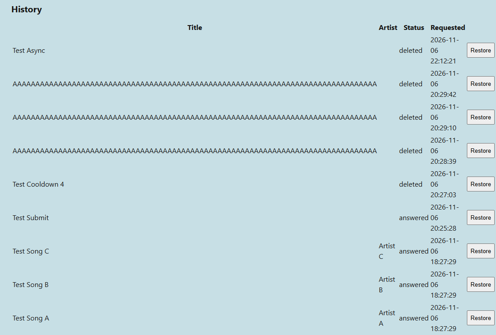

# DVA_231_PRO1
Collaborative Queue and Upvote Board

# Task - Develop an anonymous song-request queue for a live event.
Users submit items and upvote existing ones (restricted to one vote per item using a session token or hashed IP stored in the database), 
while an AJAX loop dynamically re-orders the DOM list using CSS transitions whenever rankings change. 
A passkey-protected moderator view adds a button to each item that allows marking items as "answered" or delete spam. 
Passkey can be hardcoded in the application.

# Folder Structure
Maintain a clean root folder with only required php files and README.md
- includes/ - Files to include: db.php and .htaccess
- styles/ - CSS
- js/ - Javascript
- sql/ - SQL
- actions/ - Put in files that are called by POST/GET, no need to be in main root

# Task List - Ordered by Priority
- [x] mysql/schema.sql - create database + songs and votes tables
    - [x] mysql/test_data.sql - inserts test data to songs and votes db
    - [x] Tested duplicate votes manually in phpMyAdmin

- [x] includes/db.php -  settings, hardcoded mod passkey, session_start, connection
    - [x] includes/.htaccess - prevents client from accessing secrets
    - [x] Tested db connection with test.php
    - [x] Tested db connection refusal when wrong db password

- [ ] index.php - simple layout to test list.php, submit.php, vote.php and queue.js
    - [x] Simple form for submit.php
    - [x] Tables dont work, used div rows instead, that shows songs
        - [x] Dive rows is updated from JSON from list.php and shown by AJAX queue.js
        - [x] Simple button for vote.php inside div rows
    - [ ] Missing index.php?error= redirects

- [x] submit.php - validate title/artist, insert title/artist into db as song_id pkey, redirect back
    - [x] Tested normal song sent to db no issues
    - [x] Tested 30 second cooldown with timestamp
    - [x] Tested whitespaces, are rejected server side
    - [x] Tested title and artist form with more than limit, are rejected server side
    - [x] Tested emojis, utf8 works properly
    - [x] Tested XSS payloads, gets stored as plaintext in db
    - [x] Tested SQLi payloads, gets stored as plaintext in db
    - [x] Tested redirects to index.php?error=

- [x] list.php - return open songs with vote counts as JSON, must be sorted
    - [x] Tested JSON returns properly sorted and counts all votes

- [ ] queue.js - poll list.php every 3s, create/update/remove rows(songs), vote form per row
    - [x] Tested manually adding vote to song, updates and adds the vote
    - [x] Tested adding new song using form, shows new song
    - [x] Tested XSS and SQLi payloads in plaintext db, they don't run in queue.js
    - [x] Rows moving animation missing
    - [x] Position of rows don't change in real time as CSS is required to enforce top:
    - [x] Haven't tested removal of songs using mod_action.php - works now
    - [ ] Screenreaders have issues, HTML in queue doesn't update
    - [x] Simple button for vote.php inside div rows generated by queue div row
    - [x] Bug when no songs left, can't remove the last div row song, must move the removeOldRows outside the loop

- [x] vote.php - validate song_id pkey, session id as token, insert into db +1 to vote count, redirect back
    - [x] Simple button for vote.php inside div rows, button generated inside queue
    - [x] When pressing button inside the div row, send vote.php POST with song id
    - [x] Validation of session id token (did he vote in the same song?)
    - [x] Validation of song id and status (is this song open?)
    - [x] All validation passes = Insert user token into db on the song id

- [x] mod.php - hardcoded passkey form; when logged in, table with Answered/Delete per song, recycle list.php etc
    - [x] Mod enters mod.php manually, maybe a link somewhere in index
    - [x] Same list as regular user or another list? = Data attribute container
    - [x] Should it have the same animation or just pool up? Yes and yes
    - [x] Answered and deleted should recycle div rows from queue.js to show answered and deleteds only
    - [x] Tested SQLi and XSS, shown as plaintext from db, don't trigger alert
    - [x] Tested index view, guest user can view mod buttons if they put isMod = true; queue.textContent = ''; in console
        - [x] Even with mod view they shouldn't be able to trigger any action from mod_action.php safeguards
    - [x] 2 tables, one dynamically polls with AJAX, one refreshes with the page for history

- [x] mod_action.php - check session, update song, redirect back to mod.php
    - [x] Tested, users without mod can't trigger the action, gets 403 forbidden
    - [x] Tested, SQLi and XSS payloads in db, don't trigger on answer/delete and restore button
    - [x] Answer and Delete work as intended, warning when deleting
    - [x] History added to see previous answered and deleted songs
    - [x] History baked into the HTML generated over SQL fetch table
    - [x] See More button in history to expand when more than 5 songs.
    - [x] Sort and Filter by in the history would be helpful, look this up - probably not needed

- [x] style/style.css - layout and styling
    - [x] Queue animation when ranking changes
        - [x] Adding this broke the history table in mod.php - fixed previously
    - [x] Page layout; font, centred column, padding
    - [x] Form buttons instead of default html ones
    - [x] Div rows; need border, padding and overflow for long titles
        - [x] TODO: Fix the history view table - css added + class tags
        
    - [x] Adding phone support viewports
        - [x] Phone bottom view looks constrained, change this
        - [x] Added Show All button for mod history view
        - [x] Added vertical scroll to mod history view

# Final Tasks
- [ ] Reorder php files into designated folders
- [ ] Sending song request and voting, hard refreshes the page, look up fix
- [ ] Harden mod password login
- [x] Logout link in mod site looks ugly and also show all button
- [x] Change logout GET to POST
- [x] Remember to add error messages in index.php, ?error= 
- [x] Clean up code and test files, test.php and test_data.sql
- [ ] Show which songs you've voted for - grey out button
- [x] Add button to clear all queued songs (finishing an event button)